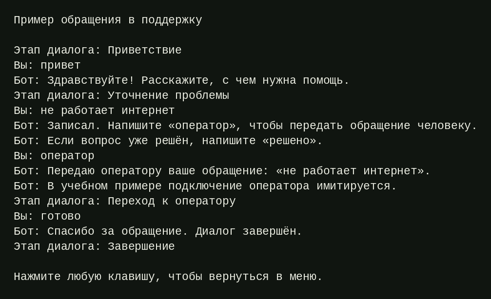
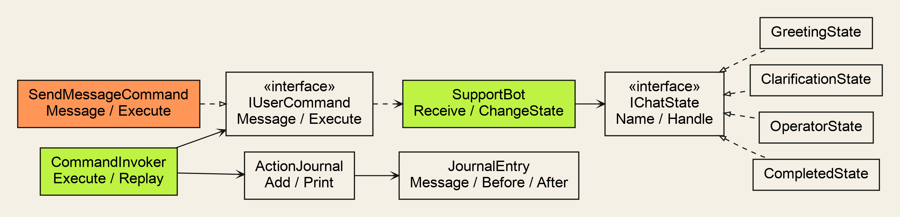

# Чат-бот технической поддержки

Консольное приложение на C# и .NET 8 для обработки обращений в техническую поддержку с использованием паттернов State и Command.

**Вариант 13**

[Запуск](#запуск) · [Результат работы](#результат-работы) · [Диаграмма классов](#диаграмма-классов) · [Использованные паттерны](#использованные-паттерны)

## Результат работы

Диалог состоит из четырёх этапов: приветствие, уточнение проблемы, передача оператору и завершение. Пользователь вводит сообщения, а бот отвечает в зависимости от текущего этапа. Смена состояния отображается в консоли.



Передача оператору имитируется, подключения к службе поддержки нет. Через меню доступны просмотр журнала, повтор последнего диалога и сравнение ответов на слово «помощь» на разных этапах.

## Диаграмма классов



На диаграмме представлены классы диалога, команд и журнала. `SupportBot` хранит текущее состояние и получает сообщения, передаваемые командами.

## Использованные паттерны

### State — «Состояние»

Обработка сообщений разделена между четырьмя классами: `GreetingState`, `ClarificationState`, `OperatorState` и `CompletedState`. Все они реализуют интерфейс `IChatState`. Класс `SupportBot` хранит текущее состояние и передаёт ему сообщение для обработки. State выбран потому, что ответ на один и тот же ввод зависит от этапа диалога. Например, на слово «помощь» бот выдаёт разные подсказки при приветствии и после передачи оператору. Каждый класс содержит правила своего этапа и переходы к другим состояниям.

### Command — «Команда»

Сообщение пользователя хранится в объекте `SendMessageCommand`, который реализует интерфейс `IUserCommand`. Класс `CommandInvoker` выполняет команды, сохраняет их в истории и записывает результат в журнал. Command используется для повторного выполнения диалога: метод `Replay` создаёт новый экземпляр `SupportBot` и последовательно выполняет сохранённые команды. Исходная история и журнал при этом остаются без изменений. Такой подход позволяет использовать одни и те же действия как при обычном вводе, так и при повторе разговора.

## Запуск

Для запуска требуется [.NET SDK 8](https://dotnet.microsoft.com/download/dotnet/8.0).

Репозиторий можно скачать через **Code → Download ZIP** и распаковать. Команда выполняется в корневой папке репозитория, рядом с `README.md`:

```bash
dotnet run --project SupportChatBot
```

Либо из папки, содержащей `SupportChatBot.csproj`:

```bash
dotnet run
```

### Проверка работы

В главном меню выбирается пункт **«Поговорить с ботом»**. Управление меню — стрелками **↑ / ↓** и клавишей **Enter**.

Пример последовательности сообщений:

```text
привет
не работает интернет
оператор
готово
```

В результате диалог проходит следующие этапы:

```text
Приветствие → Уточнение проблемы → Переход к оператору → Завершение
```

Пункт **«Открыть журнал»** показывает введённые сообщения и состояния до и после их обработки. Пункт **«Повторить последний диалог»** запускает сохранённую последовательность сообщений на новом боте.

## Ограничения

- Передача оператору имитируется.
- Команды распознаются по ключевым словам.
- История и журнал хранятся в памяти и удаляются после закрытия приложения.
- Новый разговор заменяет историю предыдущего.
